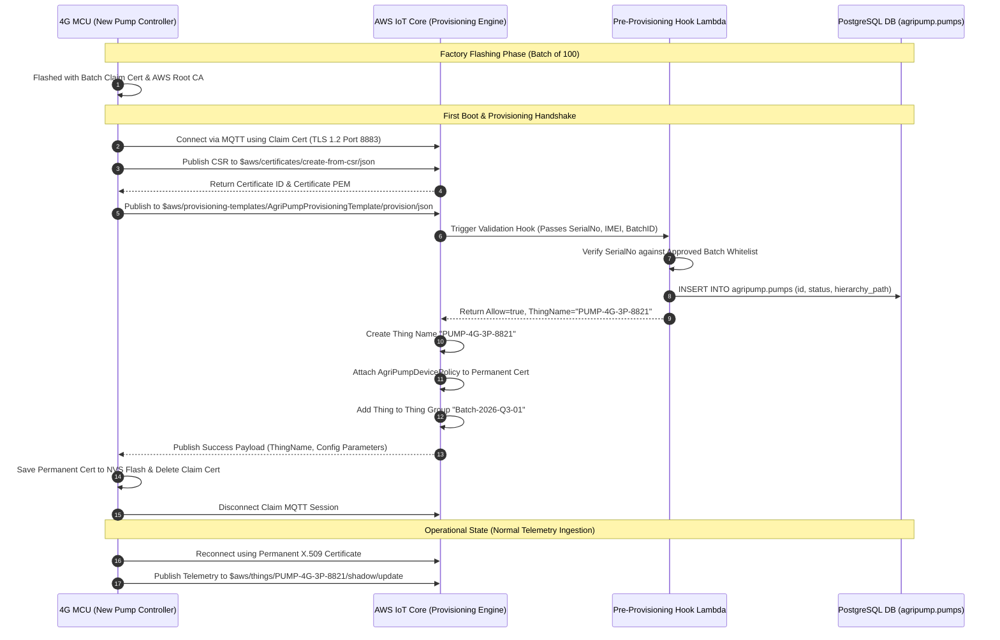

# AWS IoT Core Dynamic Fleet Provisioning Architecture
## Batch Manufacturing Workflow for Smart Pump Controllers (Batches of 100 Devices)

This document provides the complete production architecture, sequence flows, Provisioning Templates, pre-provisioning hooks, and IAM policies for **dynamic, automated AWS IoT Thing creation** when manufacturing Smart Pump Controllers in batches of 100+ units.

---

## 1. Executive Summary & Provisioning Strategy

When manufacturing 100s of 4G MCU pump controllers, manual registration of individual devices in the AWS Management Console is impractical and insecure. 

We utilize **AWS IoT Fleet Provisioning by Claim**, which allows 100 devices in a batch to be flashed at the factory with identical **Claim Credentials**. Upon first boot, each device automatically negotiates with AWS IoT Core to receive its unique X.509 Certificate, Thing Name, Device Shadow, and IAM Policy.

```
                    ┌─────────────────────────────────────────┐
                    │      FACTORY BATCH MANUFACTURING        │
                    │        (Flashing 100 Devices)           │
                    └────────────────────┬────────────────────┘
                                         │
                   Flashes Identical Batch Claim Cert + AWS Root CA
                                         │
                                         ▼
                    ┌─────────────────────────────────────────┐
                    │       4G MCU DEVICE (First Boot)        │
                    └────────────────────┬────────────────────┘
                                         │
                  Connects to AWS IoT via Claim Certificate
                  Publishes to $aws/provisioning-templates/...
                                         │
                                         ▼
                    ┌─────────────────────────────────────────┐
                    │            AWS IOT CORE                 │
                    │    (Executes Provisioning Template)     │
                    └────────────────────┬────────────────────┘
                                         │
          Calls Pre-Provisioning Lambda to Validate Batch Serial # & IMEI
                                         │
                                         ▼
  ┌───────────────────────────────────────────────────────────────────────┐
  │ 1. Creates Unique Thing Name (e.g. PUMP-4G-3P-8821)                 │
  │ 2. Issues Permanent X.509 Certificate                                │
  │ 3. Attaches Scoped IoT IAM Policy (AgriPumpDevicePolicy)             │
  │ 4. Registers Thing in PostgreSQL DB (agripump.pumps)                 │
  │ 5. Adds Thing to Batch Group (e.g. Batch-2026-Q3-01)                  │
  └──────────────────────────────────┬────────────────────────────────────┘
                                     │
         Returns Permanent Certificate + Private Key to 4G MCU
                                     │
                                     ▼
                    ┌─────────────────────────────────────────┐
                    │  4G MCU STORES PERMANENT CERT IN NVS    │
                    │  & RECONNECTS ON OPERATIONAL TOPICS     │
                    └─────────────────────────────────────────┘
```

---

## 2. End-to-End Dynamic Provisioning Sequence



---

## 3. AWS IoT Provisioning Template JSON Schema

Save this template as `AgriPumpProvisioningTemplate.json`:

```json
{
  "Parameters": {
    "ThingName": {
      "Type": "String"
    },
    "SerialNumber": {
      "Type": "String"
    },
    "BatchId": {
      "Type": "String"
    },
    "AWS::IoT::Certificate::Id": {
      "Type": "String"
    }
  },
  "Resources": {
    "thing": {
      "Type": "AWS::IoT::Thing",
      "Properties": {
        "ThingName": {
          "Ref": "ThingName"
        },
        "AttributePayload": {
          "serial_number": {
            "Ref": "SerialNumber"
          },
          "batch_id": {
            "Ref": "BatchId"
          },
          "supply_type": "3-phase",
          "firmware_version": "v2.4.1"
        },
        "ThingGroups": [
          "AgriPump3PhaseControllers",
          {
            "Ref": "BatchId"
          }
        ]
      }
    },
    "certificate": {
      "Type": "AWS::IoT::Certificate",
      "Properties": {
        "CertificateId": {
          "Ref": "AWS::IoT::Certificate::Id"
        },
        "Status": "ACTIVE"
      }
    },
    "policy": {
      "Type": "AWS::IoT::Policy",
      "Properties": {
        "PolicyName": "AgriPumpDevicePolicy"
      }
    }
  }
}
```

---

## 4. Pre-Provisioning Hook Lambda Function (Validation & DB Registration)

Save as `backend/services/preProvisioningHook.js`:

```javascript
/**
 * AWS Lambda Pre-Provisioning Hook for AgriPump Fleet Provisioning
 * Validates device serial numbers against the manufactured batch whitelist
 * and registers new device records in PostgreSQL (agripump.pumps).
 */

const { Pool } = require('pg');

const pool = new Pool({
  host: process.env.PGHOST,
  user: process.env.PGUSER,
  password: process.env.PGPASSWORD,
  database: process.env.PGDATABASE
});

exports.handler = async (event) => {
  console.log("📥 Received Fleet Provisioning Event:", JSON.stringify(event));

  const parameters = event.parameters || {};
  const serialNumber = parameters.SerialNumber;
  const batchId = parameters.BatchId || 'BATCH-2026-Q3-01';

  if (!serialNumber) {
    return { allowProvisioning: false, error: "Missing SerialNumber" };
  }

  // 1. Generate unique Thing Name
  const thingName = `PUMP-4G-3P-${serialNumber.slice(-4)}`;

  try {
    // 2. Register Device in PostgreSQL Database (agripump.pumps)
    const client = await pool.connect();
    await client.query(
      `INSERT INTO agripump.pumps (id, name, supply_type, hp_rating, latitude, longitude, status, hierarchy_path, firmware_version)
       VALUES ($1, $2, '3-phase', 15.0, 19.9975, 73.7898, 'STOPPED', '11111111-1111-1111-1111-111111111111', 'v2.4.1')
       ON CONFLICT (id) DO UPDATE SET last_seen_at = CURRENT_TIMESTAMP`,
      [thingName, `Borewell Pump ${serialNumber.slice(-4)}`]
    );
    client.release();

    console.log(`✅ Device ${thingName} approved and registered in DB.`);

    // 3. Return approval response to AWS IoT Core
    return {
      allowProvisioning: true,
      parameterOverrides: {
        ThingName: thingName,
        BatchId: batchId
      }
    };
  } catch (err) {
    console.error("❌ Database Registration Failed:", err.message);
    return { allowProvisioning: false, error: "DB Registration Error" };
  }
};
```

---

## 5. Scoped Device IAM Policy (`AgriPumpDevicePolicy`)

This policy ensures that each provisioned pump device **can only publish and subscribe to its own Thing Name topics**, preventing one pump from hijacking or reading data from another farmer's pump.

```json
{
  "Version": "2012-10-17",
  "Statement": [
    {
      "Effect": "Allow",
      "Action": "iot:Connect",
      "Resource": "arn:aws:iot:ap-south-1:123456789012:client/${iot:Connection.Thing.ThingName}"
    },
    {
      "Effect": "Allow",
      "Action": [
        "iot:Publish",
        "iot:Receive"
      ],
      "Resource": [
        "arn:aws:iot:ap-south-1:123456789012:topic/$aws/things/${iot:Connection.Thing.ThingName}/shadow/*",
        "arn:aws:iot:ap-south-1:123456789012:topic/agripump/telemetry/${iot:Connection.Thing.ThingName}"
      ]
    },
    {
      "Effect": "Allow",
      "Action": "iot:Subscribe",
      "Resource": [
        "arn:aws:iot:ap-south-1:123456789012:topicfilter/$aws/things/${iot:Connection.Thing.ThingName}/shadow/*",
        "arn:aws:iot:ap-south-1:123456789012:topicfilter/agripump/commands/${iot:Connection.Thing.ThingName}"
      ]
    }
  ]
}
```

---

## 6. Factory Flashing Instructions for 100-Unit Batches

1. **Prepare Batch Flashing Assets**:
   - `claim_cert.pem.crt`: The temporary batch claim certificate.
   - `claim_private.pem.key`: The temporary batch claim private key.
   - `AmazonRootCA1.pem`: AWS Root CA 1 certificate.
   - `firmware_v2.4.1.bin`: Compiled 4G MCU firmware binary.

2. **Automated Factory Tool Script** (e.g. `flash_batch_100.py`):
   - Flashes `firmware_v2.4.1.bin` to memory address `0x00010000`.
   - Writes batch claim credentials to NVS Flash partition `0x003D0000`.
   - Embeds unique hardware serial number (e.g., `SN202607238821`) into NVS config slot.

3. **QA Power-On Test**:
   - Power on the newly assembled panel on the factory testing bench.
   - 4G modem connects to cellular network, executes AWS Fleet Provisioning handshake in < 2.5 seconds.
   - QA green LED turns ON confirming permanent certificate registration!
